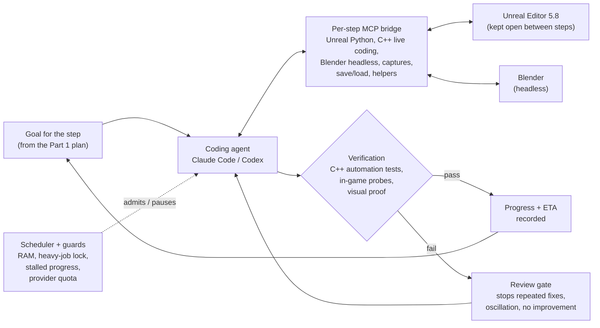

# Soul Arena — building an Unreal Engine 5 game with a pipeline of AI agents (technical showcase)

> **Showcase only.** Architecture and small code samples. The game, its source code and its assets are private.
> All rights reserved. Gameplay footage will be added when Part 1 reaches release-quality art.

**Soul Arena** is an original third-person action RPG in **Unreal Engine 5.8** (C++ and editor Python).
The interesting part, technically, is *how* it is built: I set the design, architecture and rules, and a
pipeline of AI coding agents (Claude Code, Codex) implements, tests and verifies the game one step at a time,
day and night, on a single 16 GB workstation.

## The step pipeline

- **One step = one goal.** An agent gets a goal from the plan, the editor and tools through a temporary MCP bridge,
  and has to bring evidence: tests passing, a probe that plays the scenario, captures from the right camera.
  No evidence, no "done".
- **Editor automation.** Levels, materials, NPCs, lighting, imports and captures are authored by Python scripts
  run inside the editor, so every change is repeatable and can be reviewed and re-run.
- **C++ live coding.** Gameplay code is rebuilt without closing the editor when possible; full builds are
  serialized behind a lock, with a single compiler on low-memory days.
- **Guards.** One heavy job at a time (editor, build, Blender), memory checks before starting anything heavy,
  stalled-progress and missing-proof detection. The chain survives provider quota limits and resumes on reset.
- **Review gate.** Recognizes when an agent is fixing the same defect again, oscillating between two versions, or
  not improving, and stops the loop instead of burning time.
- **Asset policy.** Reuse-first from approved sources (own models, licensed marketplace kits, CC0 libraries), with a
  registry of every external asset and its licence.

## The game (private code)

- **Combat:** light/heavy attacks, dodge, block, parry, posture, hit reactions, attack telegraphs, data-driven moves.
- **Enemies and bosses:** multi-phase bosses, coordinated encounters, spawning and death effects (Niagara).
- **Progression:** stats, balancing, equipment, a "Resonance" system that adapts to how you play.
- **Quests and economy:** guild board, missions, shops, items, gathering.
- **Narrative direction:** prologue, triggers, persistent choices, dialogue, segment transitions.
- **UI and persistence:** HUD, menus, journal, map and minimap, checkpoints, save/load, death and rebirth.

Built on the **Gameplay Ability System**, Enhanced Input, Niagara, Navigation, Smart Objects and Level Sequences.
Characters come from two pipelines: VRoid → Blender (headless) → Unreal for NPC variants, and a Blender → Unreal
high-quality pipeline (UE5 skeleton fitting, skin weights, cloth and hair chains, pose tests).

Numbers (November 2026): 63 Unreal classes, 34 C++ automation test files, about 1,150 editor and Blender Python
scripts. Status: Part 1 in development; combat and systems are playable, art is still prototype.

## Code samples

[`code/AttackTelegraph.h`](code/AttackTelegraph.h) and [`code/AttackTelegraphTest.cpp`](code/AttackTelegraphTest.cpp):
the pure rules behind the attack warnings (weapon flash, lethal-hit vignette, enraged glow), kept free of engine
state so they can be unit-tested. This is the pattern used across the project: rules as pure functions, a thin
component that applies them, and an automation test that pins the numbers. Simplified excerpt.

## Licence

© 2026 sas0208. **All rights reserved** — see [LICENSE](LICENSE).
